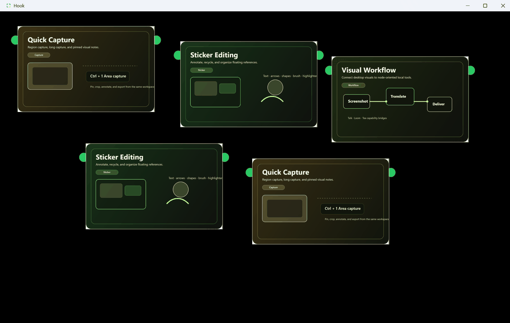

<h1 align="center">Otter</h1>

<strong>Capture it. Pin it. Make it yours.</strong> Connect nodes. Create effects. Turn your desktop into a creative workspace.

  Website ·
  <a href="https://github.com/aiaimimi0920/Otter/releases">Download</a> ·
  <a href="./docs/README.md">Documentation</a> ·
  <a href="https://github.com/aiaimimi0920/Otter/issues">Feedback</a>

  
  
  

English · <a href="./README.zh-CN.md">简体中文</a>

Otter is a free, open-source screenshot tool that brings capturing, annotating,
organizing and sharing into your everyday work. Turn your desktop into a workbench:
connect different processing nodes to combine functions, create effects and
explore more possibilities for the images you capture.

A desktop workspace · Show / hide animation

  

[Features](#features) · [Get started](#get-started) · [Contribute](#contributing)

## Features

- **Capture what you need.** Region and window screenshots, long captures, live captures and a screen color picker.
- **Keep it on your desktop.** Persistent stickers, a focused canvas, groups, a reference library and history.
- **Make the image yours.** Crop, erase, rotate and annotate with text, arrows, shapes, brushes, blur and mosaic; undo and redo your edits.
- **Work with live content.** Capture a program region into a live sticker; supported source windows allow interaction. Compatibility and resource limits apply.
- **Add local capabilities.** OCR, translation and Art workflows through installed, enabled and authorized Loom capabilities.
- **Project to another device.** Image projection and LiveRelay through paired Loom connections, with receiver controls and server authorization.

[**Explore capabilities and shortcuts →**](./docs/FEATURES.md) · [Live capture](./docs/LIVE_CAPTURE.md) · [Image projection](./docs/QR_PROJECTION.md)

## Get started

**To use Otter:** you need Windows 10 or 11 and the WebView2 Runtime. Download the
portable ZIP from [Releases](https://github.com/aiaimimi0920/Otter/releases),
extract it, and run the executable included in that package.

| Start here | What you need to do |
| --- | --- |
| [Download a release](https://github.com/aiaimimi0920/Otter/releases) | Choose the portable ZIP, not GitHub's source-code archive. An optional matching `.zip.sha256` file lets you verify the download. |
| Capture and edit locally | Launch the app and press `Ctrl+1` to capture a region. Loom is not required for local capture and editing. |
| Use OCR or translation | Start Loom, install and enable the corresponding capabilities, and authorize Otter's connection. Then select an image sticker. |
| [Build from source](./docs/guide/development.md) | Use Node.js 22+ and Rust stable with the MSVC toolchain on Windows. |

1. Press **`Ctrl+1`** for a region screenshot, **`Ctrl+2`** for live capture, or **`Ctrl+3`** for a long capture.
2. Select a sticker and press **`Ctrl+E`** to toggle its editing toolbar.
3. With the required Loom capabilities available, use **`Ctrl+4`** for OCR and **`Ctrl+5`** for translation; **`Alt+4` / `Alt+5`** toggle their results.

## Contributing

Bug reports, translations, documentation improvements and code contributions are welcome.
Start with [ways to contribute](./docs/guide/contributing.md) or the
[translation guide](./docs/guide/translating.md), and explore the
[repository layout](./TECHNICAL_ARCHITECTURE.md#2-repository-layout) to understand the code structure.
Code changes follow the [engineering contribution guide](./CONTRIBUTING.md).
Search [existing issues](https://github.com/aiaimimi0920/Otter/issues) before reporting a problem.

## License

Otter-owned code is [MIT licensed](./LICENSE). Dependencies retain their own
[licenses and notices](./THIRD_PARTY_NOTICES.md).
