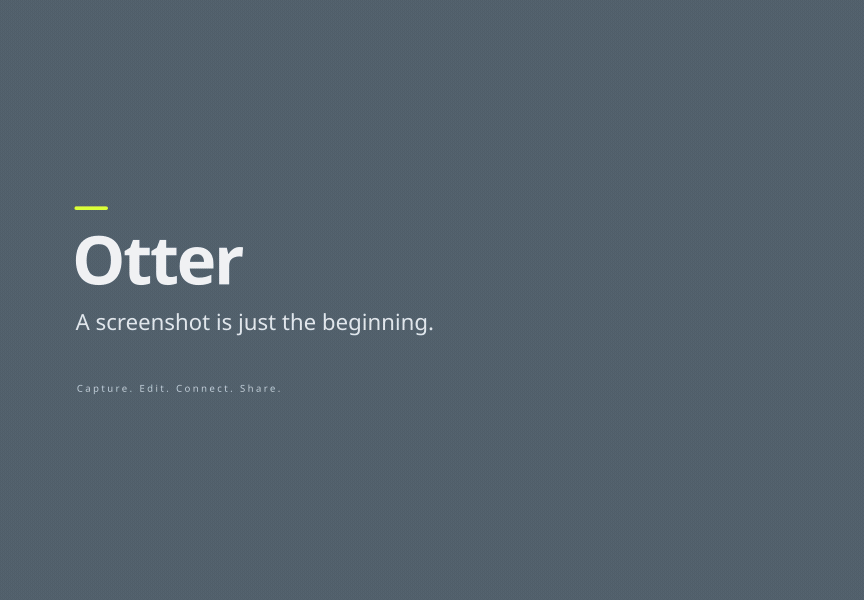

<h1 align="center">Otter</h1>

<strong>截下画面，留在桌面，改成你想要的样子。</strong> 连接节点，生成效果。让桌面成为你的创作工作台。

  官网 ·
  <a href="https://github.com/aiaimimi0920/Otter/releases">下载</a> ·
  <a href="./docs/README.md">文档中心</a> ·
  <a href="https://github.com/aiaimimi0920/Otter/issues">反馈</a>

  
  
  

<a href="./README.md">English</a> · 简体中文

Otter 是一款免费开源的截图工具，让截图、标注、整理与分享融入日常工作。
将桌面化作工作台，连接不同的处理节点，组合功能、制作效果，让截下的画面拥有更多可能。

桌面工作区 · 展开 / 收起动画

  

[功能](#功能) · [开始使用](#开始使用) · [参与贡献](#参与贡献)

## 功能

- **截下你想要的画面。** 支持区域、窗口和长截图，也能随手拾取屏幕颜色。
- **把图片钉在桌面。** 让参考图随时可见，通过分组、图库和历史记录整理素材。
- **随手标注，继续编辑。** 裁剪、擦除、旋转，添加文字、箭头与图形，也能用模糊和马赛克遮挡信息。
- **让钉图实时更新。** 把窗口或局部画面变成实时钉图，持续查看内容，并与支持的源窗口交互。
- **连起节点，组合效果。** 接入 Loom 的 OCR、翻译和 Art 能力，通过连线组装自己的处理流程。
- **把画面投向其他设备。** 将图片或实时画面投射到已连接、配对的设备，方便跨屏查看与协作。

[**完整功能 →**](./docs/FEATURES.md)

## 开始使用

- **截取钉图：** 截取桌面上任意画面，将画面钉在桌面的任意位置。
- **快速编辑：** 使用编辑栏内的工具，对钉图进行快速的标注处理。
- **连接流程：** 使用 Loom 的节点工具，进行高级工作流组装处理。
- **分享画面：** 使用推送工具，将贴图的画面推送给任意客户端。

| 从这里开始 | 需要做什么 |
| --- | --- |
| [下载 Otter](https://github.com/aiaimimi0920/Otter/releases) | 解压并启动 Otter App，即可开始使用。 |
| 下载 Otter + Loom | 解压并启动 Otter App 和 Loom App。在 Loom 中安装 OCR、翻译等能力包，也可按需添加常用的 MCP 工具和 Art 节点，拓展你的创作工作流。 |

1. 按 **`Ctrl+1`** 区域截图、**`Ctrl+2`** 实时截图，或 **`Ctrl+3`** 长截图。
2. 选中钉图，按 **`Ctrl+E`** 显示或隐藏编辑工具栏，**`Tab`** 展开或收起参数面板；退出编辑或选择状态后，按 **`Esc`** 删除钉图。
3. 对应 Loom 能力可用时，按 **`Ctrl+4`** 进行 OCR 识别，**`Alt+4`** 切换识别结果显示；按 **`Ctrl+5`** 翻译，**`Alt+5`** 切换翻译结果显示；按 **`Shift+1`** 打开 Art 菜单，添加新的节点。
4. 选中钉图，打开工具栏，选择投射按钮，可以投射钉图到任意可连接的设备上。

[**完整使用教程 →**](./docs/guide/getting-started.zh-CN.md)

## 参与贡献

欢迎反馈问题、参与翻译、改进文档或贡献代码。
从[社区参与方式](./docs/guide/contributing.zh-CN.md)或[翻译教程](./docs/guide/translating.zh-CN.md)开始，
也可以从[项目目录说明](./TECHNICAL_ARCHITECTURE.md#2-repository-layout)了解代码结构。
代码修改请遵循[工程贡献规范](./CONTRIBUTING.md)，反馈前先搜索[已有 Issues](https://github.com/aiaimimi0920/Otter/issues)。

## 许可证

Otter 自有代码采用 [MIT 许可](./LICENSE)，依赖保留各自的[许可与声明](./THIRD_PARTY_NOTICES.md)。
